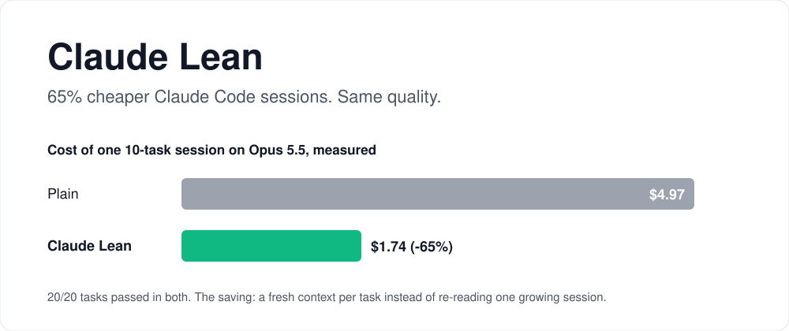

<div align="center">

# Claude Lean

### Spend less on Claude Code. Keep the quality.

Every Claude Code request re-sends your whole session: the history, every tool definition, every line of test output. Claude Lean cuts what gets re-sent, so the same work costs **65% less on long sessions** and **32-74% less on short tasks**, with the same tasks passing.

One command. Runs locally. Open source, no account, no telemetry.

[](https://www.npmjs.com/package/claude-lean)
[](https://github.com/JacobTheJacobs/claude-lean/actions/workflows/ci.yml)
[](LICENSE)
[](#security--privacy)
[](#security--privacy)
[](https://github.com/JacobTheJacobs/claude-lean)

**[Get started](#get-started)** · **[How it works](#how-it-works)** · **[Capabilities](#capabilities)** · **[Benchmark](#benchmark)** · **[vs JFrog Boost](#vs-jfrog-boost)** · **[Changelog](CHANGELOG.md)**


<sub>Every frame is real output from claude-lean 0.2.1.</sub>

</div>

## Results

| Workload | Plain Claude Code | With Claude Lean | Saved | Tasks passed |
|---|--:|--:|--:|:-:|
| Long session: 10 tasks in a row, Opus 5.5 | $4.97 | **$1.74** | **65%** | 20/20 both |
| Short task, Haiku 5.5 | $0.0078 | **$0.0053** | **32%** | 15/15 both |
| Short task with `claude-lean lite`, Haiku 5.5 | $0.0081 | **$0.0021** | **74%** | 15/15 both |

Cost per session (long) or per task (short). A script grades every answer. [Full benchmark](#benchmark).

> [!NOTE]
> Every number here comes from an eval in [`evals/`](evals/) that you can re-run yourself. When a result went against us, it's on this page too.

## Get started

### ⌨️ npm

```bash
npx claude-lean init
```

That's it. Your next Claude Code session uses it. Preview the changes with `--dry-run`, undo them with `npx claude-lean uninstall`.

### 📦 Without npm

```bash
git clone https://github.com/JacobTheJacobs/claude-lean.git && claude-lean/install.sh
```

Needs Python 3.8+ on macOS, Linux or WSL, plus Node 18+ for `npx`.

## Works with

| Agent | Command | What gets installed |
|---|---|---|
| Claude Code | `npx claude-lean init` | 4 hooks, 2 skills and 6 settings in `~/.claude/settings.json` (backed up first) |
| Claude Code, quick jobs | `npx claude-lean lite` | Nothing. Starts Claude Code with only the core tools. |

Your own hooks, settings, MCP servers and skills are left alone. Run `init` again any time to update.

## How it works

Claude Code has no memory between requests, so each one re-sends everything: the system prompt, every tool definition, and the whole conversation so far. By task 10 of a long session, every request carries ~175K tokens. That re-reading, not the code Claude writes, is most of your bill.

```
                 ┌─────────────────────── every request ───────────────────────┐
  plain          │ tool definitions 17K+ │ session history, growing every turn │
                 └─────────────────────────────────────────────────────────────┘
                 ┌──────────────┬──────────────┐
  Claude Lean    │ slim / lite  │ this task    │   /clear + handoff note between tasks,
                 └──────────────┴──────────────┘   noisy output trimmed before it lands
```

Claude Lean shrinks each part:

1. **History.** A hook watches the session size. Past 100K tokens it tells you a fresh start will pay off. Say "handoff" first, and the next session starts from a short note instead of the whole transcript.
2. **Fixed overhead.** Six built-in Claude Code switches drop features most sessions never use. `lite` goes further for quick jobs.
3. **Noise.** A 400-test pytest run arrives as 13 lines. Every failure and summary stays; the full original is one command away.

## Capabilities

### Save tokens

- **Long-session guard.** Once a session passes 100K tokens (`LEAN_CLEAR_AT`), you get one line: "New task? `/clear` first." It's shown to you, never sent to the model, and stays silent on short sessions.
- **Handoff.** Say "handoff" before `/clear`. Claude saves a short note (goal, progress, next steps), and the next session in that folder starts with it. Used once; expires after 12 hours.
- **Slim.** On by default. Turns off Artifacts, Workflows, git instructions, background tasks, cron and the advisor tool, which cuts a typical setup from 49.5K to 24.9K tokens per request. Skip it with `--no-slim`.
- **Lite.** `npx claude-lean lite` starts Claude Code with just Read, Edit, Write, Bash, Grep, Glob, Agent and TodoWrite: no MCP servers, no skills. On a clean install that's 5.4K tokens before you type instead of 17.2K. `--keep-mcp` and `--keep-skills` bring those back.
- **Output filter.** For pytest, jest, npm, pip, cargo, go, docker, make and more. Drops progress bars, download chatter, passing tests and repeated lines; keeps errors, tracebacks and summaries. Dev servers and watchers are never touched.
- **Audit.** `npx claude-lean audit` finds skills and MCP servers you load on every request but never use.
- **Memory check.** `npx claude-lean memory` shows what your memory files and CLAUDE.md add to every request.

### Stay safe

- **Nothing is lost.** Every trimmed output is saved, and `npx claude-lean get <id>` brings back the original. If Claude needs the originals from one tool three times, that tool's filter switches itself off.
- **Never in the way.** A failing hook exits quietly instead of breaking your session. The filter never approves a command, so your permission rules still apply.
- **Cache guard.** Warns you before a mid-session edit to CLAUDE.md or settings, which forces the whole prompt cache to be rebuilt.
- **Clean uninstall.** `npx claude-lean uninstall` removes exactly what it added, cache included.

### See the impact

```bash
npx claude-lean report --days 7       # where your money went: by model, project and session, with fixes
npx claude-lean stats                 # what the output filter saved, per tool
LEAN_DAY_USD=10 npx claude-lean init  # daily spending cap: warns at 80%, stops at 100%
```

## Benchmark

<picture>
  <source media="(prefers-color-scheme: dark)" srcset="docs/hero-dark.svg">
  
</picture>

The same 10 tasks, in order, on a test repo (a Python package with 12 modules and a 20,000-line log): fix a bug, add a function, then 8 lookups and counts. A script grades every answer (`evals/check.py`). Claude Code 2.1.322, 2 sessions per setup.

| 10-task session | Passed | Cost per session |
|---|:-:|--:|
| Plain Claude Code, Opus 5.5 | 20/20 | $4.97 |
| **Claude Lean, Opus 5.5** | **20/20** | **$1.74 (-65%)** |
| Plain Claude Code, Haiku 5.5 | 20/20 | $0.169 |
| **Claude Lean, Haiku 5.5** | **20/20** | **$0.058 (-66%)** |

Plain Claude Code gets more expensive with every task, because it re-reads everything that came before. Claude Lean stays flat. The same small task costs 4x more at step 10 of a long session than in a fresh one.

Short tasks (5 quick jobs, 3 runs each, Haiku 5.5), each setup compared with plain in the same batch:

| Short task | Passed | Plain | With Claude Lean |
|---|:-:|--:|--:|
| Slim (on by default) | 15/15 both | $0.0078 | **$0.0053 (-32%)** |
| `claude-lean lite` | 15/15 both | $0.0081 | **$0.0021 (-74%)** |

The output filter, honestly: it cuts a 400-test pytest run or a 350-line `make` log by over 90%, but on a single task that's only 1-4% of the bill, because each request also carries the fixed overhead. It pays off when big outputs pile up over a long session.

```bash
python3 evals/long.py --reps 2 --model claude-opus-5-5 --arms plain,lean   # about $13
python3 evals/long.py --reps 2                                              # Haiku, about $0.50
```

Each session stops at `--budget` dollars (default $2), so a re-run can't surprise you.

### vs JFrog Boost

Same graded tasks, same machine, Haiku 5.5. JFrog Boost v0.17.5 was installed with `boost init --claude` in a separate HOME (2026-11-19, `evals/vs.py`). Every run is counted:

| 10-task session | Passed | Cost per session |
|---|:-:|--:|
| Plain Claude Code | 88/90 | $0.172 |
| JFrog Boost | 35/40 | $0.173 (+3% vs plain in the same batches) |
| **Claude Lean** | 80/90 | **$0.052 (-70%)** |
| **Claude Lean + JFrog Boost** | 38/40 | **$0.051 (-70%)** |

| Noisy output (400-test pytest, 350-line make) | Passed | Cost per task |
|---|:-:|--:|
| Plain Claude Code | 14/14 | $0.0057 |
| JFrog Boost | 8/8 | $0.0065 (+14%) |
| Claude Lean | 14/14 | $0.0055 (-4%) |
| Claude Lean + JFrog Boost | 8/8 | $0.0047 (-17%) |

- **Cost.** Claude Lean ran at about a third of the price. JFrog Boost cost slightly more than plain Claude Code in both suites.
- **Quality.** All 10 of Claude Lean's misses came in the first two batches, 8 of them counts over the 20,000-line log. The two later batches passed 50 of 50, and Claude Lean passed every task on Opus 5.5 and in `evals/long.py`. The table counts every batch.
- **Why JFrog Boost didn't save here.** Its own local log (`history.db`) recorded 0 filtered commands across 95 sessions: on a fresh install, its remote feature flags had its terminal filter (`boost-cli-filtering`) switched off.

### Tested and rejected

We measured these on the 10-task session (2 sessions each, 2026-11-19) so you don't have to:

| Lever | Result | Passed |
|---|--:|:-:|
| Compact early (`CLAUDE_CODE_AUTO_COMPACT_WINDOW=100000`, `CLAUDE_AUTOCOMPACT_PCT_OVERRIDE=50`) | +35% | 20/20 |
| Opus 5.5 advisor on Sonnet 5.5 (`--advisor claude-opus-5-5`) | +24% | 20/20 both |
| Sonnet 5.5 instead of Haiku 5.5 | 14x the cost | 19/20 vs 20/20 |
| Opus 5.5 with subagents on Haiku (`CLAUDE_CODE_SUBAGENT_MODEL`) | -2%, noise | 20/20 both |
| Opus 5.5 at `--effort low` instead of medium | -6.5% | 20/20 both |

Long, hard work may behave differently. Measure your own with `python3 evals/levers.py`.

## Habits that save the most

1. **`/clear` between unrelated tasks.** That's the 65%. Mid-task, say "handoff" first.
2. **`/compact` by hand** when one task really needs one long session. Forcing automatic compaction earlier cost more in our test (+35%).
3. **Leave CLAUDE.md, settings, model and effort alone mid-session.** Each change forces the whole cached prompt to be rebuilt.
4. **Ask for short answers.** Output tokens cost 5x input tokens.
5. **Check `npx claude-lean report --days 7` weekly.** If cache reads dominate, your sessions run too long.

Sources: Anthropic's [cost guide](https://platform.claude.com/docs/en/about-claude/models/optimizing-for-cost-and-intelligence) and [cookbook](https://platform.claude.com/cookbook/cost-optimization-cost-optimization).

## Security & privacy

- **Local-only.** No network calls, no telemetry, no account. Nothing leaves your machine.
- **Readable.** Plain Python and JavaScript using only the standard library. No binary, no dependencies. What's on GitHub is exactly what npm installs.
- **Your logs stay put.** `report` and `audit` read `~/.claude/projects` and print to your terminal.
- **What it stores.** The last 200 trimmed outputs, in `~/.cache/claude-lean/out` (readable only by you), and a handoff note until it's used or 12 hours pass. `uninstall` deletes both.
- **Your permissions still apply.** The filter can rewrite a command, but never approves one.

## FAQ

**Why is my bill high when Claude writes so little code?** Each request re-reads the whole context. A 300K-token session re-read 50 times is 15 million tokens.

**Does it help short tasks?** Yes. The long-session guard stays out of the way there, but slim (-32%) and `lite` (-74%) cut the fixed overhead every request carries.

**Does the output filter change exit codes?** Yes. A filtered command runs through a pipe, so Claude sees exit code 0 even when tests fail. Every error and summary line is kept, so the failure still shows. To skip the filter, use `init --no-filter`.

**Can subagents run on Haiku?** Yes, with a named agent file (`model: haiku`) like [`agents/reader.md`](agents/reader.md); install it with `init --reader`. `fork` subagents always use your main model.

## Contributing

Filters for more commands help the most. See [CONTRIBUTING.md](CONTRIBUTING.md); `npm test` runs every test. Report bugs or request a filter in [issues](https://github.com/JacobTheJacobs/claude-lean/issues).

## License

MIT. Release notes are in [CHANGELOG.md](CHANGELOG.md).
