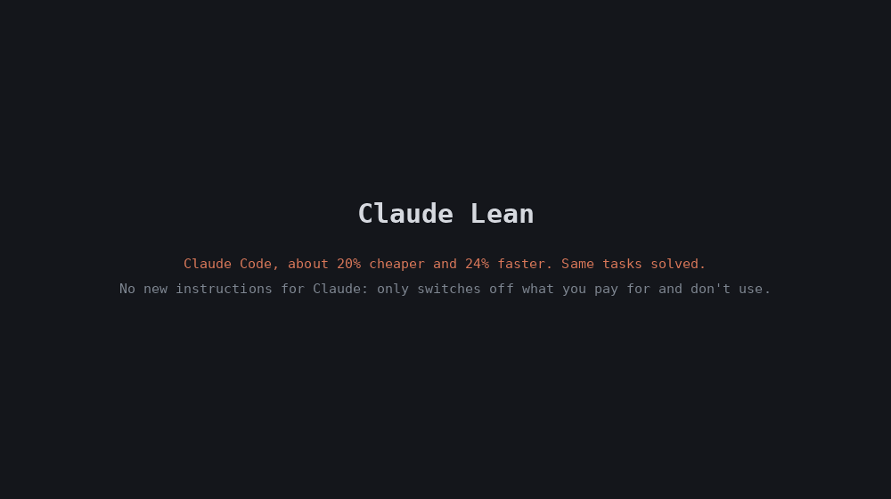

<div align="center">

### Spend less. Keep the quality.

Claude Lean cuts what Claude Code re-reads on every request: long session history, unused tool definitions, noisy test and build output. Long sessions cost 65% less on Opus 5.5 with the same tasks passed. Local, open source, no account, no telemetry.

[](https://www.npmjs.com/package/claude-lean)
[](https://github.com/JacobTheJacobs/claude-lean/actions/workflows/ci.yml)
[](LICENSE)
[](#security--privacy)
[](#security--privacy)
[](https://github.com/JacobTheJacobs/claude-lean)

**[Get started](#get-started)** · **[How it works](#how-it-works)** · **[Capabilities](#capabilities)** · **[Benchmark](#benchmark)** · **[vs JFrog Boost](#vs-jfrog-boost)** · **[Changelog](CHANGELOG.md)**



<sub>Every frame is real output from claude-lean 0.2.1.</sub>

</div>

## Result

| 10 tasks in one session, Opus 5.5 | Tasks passed | Cost per session |
|---|:-:|--:|
| Plain Claude Code | 20/20 | $4.97 |
| **With Claude Lean** | **20/20** | **$1.74 (-65%)** |

40 graded tasks, 2026-11-12. Details in [Benchmark](#benchmark).

> [!NOTE]
> Every number on this page comes from a graded eval in [`evals/`](evals/) that you can re-run. Where a result went against us, it is here too.

## Get started

### ⌨️ npm

```bash
npx claude-lean init
```

That's it. New Claude Code sessions pick it up. Preview first with `--dry-run`; undo with `npx claude-lean uninstall`.

### 📦 Without npm

```bash
git clone https://github.com/JacobTheJacobs/claude-lean.git && claude-lean/install.sh
```

Needs Python 3.8+ (macOS, Linux, WSL) and, for `npx`, Node 18+.

## Works with

| Agent | Command | What gets installed |
|---|---|---|
| Claude Code | `npx claude-lean init` | 4 hooks, 2 skills and 6 env switches in `~/.claude/settings.json`, with a backup first |
| Claude Code, quick jobs | `npx claude-lean lite` | nothing: starts Claude Code with the core tools only |

Your own hooks, settings, MCP servers and skills stay. Re-running `init` updates in place.

## How it works

Every request re-sends the whole session: the system prompt, every tool definition, and all history so far. By task 10 of a long session, each request re-reads ~175K tokens, and that re-reading is most of the bill.

```
                 ┌─────────────────────── every request ───────────────────────┐
  plain          │ tool definitions 17K+ │ session history, growing every turn │
                 └─────────────────────────────────────────────────────────────┘
                 ┌──────────────┬──────────────┐
  Claude Lean    │ slim / lite  │ this task    │   /clear + handoff note between tasks,
                 └──────────────┴──────────────┘   noisy output trimmed before it lands
```

Claude Lean attacks each part:

1. **History.** A hook watches the session size and, past 100K tokens, tells you when a fresh start pays off. Say "handoff" first and the next session starts with a short note instead of the whole transcript.
2. **Fixed overhead.** Six Claude Code switches drop features most sessions never use. `lite` goes further for quick jobs.
3. **Noise.** A 400-test pytest run lands as 13 lines: every failure and summary kept, the original one command away.

## Capabilities

### Save tokens

- **Long-session guard.** Past `LEAN_CLEAR_AT` (100K) tokens, one line to you, never to the model: "New task? `/clear` first." Silent below that.
- **Handoff.** Say "handoff" before `/clear`: Claude saves a ~15-line note (goal, done, state, next steps) and the next session in that folder starts with it. Used once, expires in 12 hours.
- **Slim.** On by default. Turns off Artifacts, Workflows, git instructions, background tasks, cron and the advisor tool: 49.5K -> 24.9K tokens per request in a typical setup. `--no-slim` skips it.
- **Lite.** `npx claude-lean lite` starts Claude Code with Read, Edit, Write, Bash, Grep, Glob, Agent and TodoWrite only: no MCP, no skills. Clean install: 17.2K -> 5.4K tokens before you type. `--keep-mcp` and `--keep-skills` keep those.
- **Output filter.** pytest, jest, npm, pip, cargo, go, docker, make and more: progress bars, download chatter, passed tests and repeats dropped; errors, tracebacks and summaries kept. Dev servers and watchers are never touched.
- **Audit.** `npx claude-lean audit` lists skills and MCP servers you load on every request but never used.
- **Memory check.** `npx claude-lean memory` shows what your memory index and CLAUDE.md add to every request.

### Stay safe

- **Reversible output.** Every trimmed output is saved; `npx claude-lean get <id>` returns the original. If Claude fetches originals of one tool 3 times, that tool's filter turns itself off.
- **Never in the way.** Hooks catch every error and exit cleanly. The filter sets no permission decision, so your permission rules and prompts still apply.
- **Cache guard.** Warns before a mid-session CLAUDE.md or settings edit, which re-writes the whole prompt cache.
- **Clean uninstall.** `npx claude-lean uninstall` removes exactly what it added, including its cache folder.

### See the impact

```bash
npx claude-lean report --days 7     # dollars by token class, model, project and session, with levers to pull
npx claude-lean stats               # what the output filter saved, per tool
LEAN_DAY_USD=10 npx claude-lean init  # daily dollar cap: warns at 80%, blocks at 100%
```

## Benchmark

<picture>
  <source media="(prefers-color-scheme: dark)" srcset="docs/hero-dark.svg">
  
</picture>

Same 10 tasks, in order, on a test repo (a Python package, 12 modules, a 20,000-line log): a bug fix, a new function, then 8 lookups and counts. A script grades every answer (`evals/check.py`). Claude Code 2.1.322, 2 sessions per setup.

| 10-task session | Passed | Cost per session |
|---|:-:|--:|
| Plain Claude Code, Opus 5.5 | 20/20 | $4.97 |
| **Claude Lean, Opus 5.5** | **20/20** | **$1.74 (-65%)** |
| Plain Claude Code, Haiku 5.5 | 20/20 | $0.169 |
| **Claude Lean, Haiku 5.5** | **20/20** | **$0.058 (-66%)** |

Plain gets more expensive with every task because it re-reads everything before it; Lean stays flat. The same small task costs 4x more at step 10 of a long session than in a fresh one.

| 5 short tasks x 3, Haiku 5.5 | Passed | Cost per task |
|---|:-:|--:|
| Full setup | 15/15 | $0.0081 |
| Slim | 15/15 | $0.0053 (-32%) |
| **`claude-lean lite`** | **15/15** | **$0.0021 (-74%)** |

Output filter, honestly: it cuts a 400-test pytest run or a 350-line `make` log by 90%+, but on a single task that is ~1-4% of the bill, because each request also carries the fixed overhead. It matters when big outputs pile up in a long session.

```bash
python3 evals/long.py --reps 2 --model claude-opus-5-5 --arms plain,lean   # about $13
python3 evals/long.py --reps 2                                              # Haiku, about $0.50
```

Every session is capped at `--budget` (default $2).

### vs JFrog Boost

Same graded tasks, same machine, Haiku 5.5. JFrog Boost v0.17.5 installed with `boost init --claude` in a throwaway HOME (2026-11-19, `evals/vs.py`). All runs, nothing dropped:

| 10-task session | Passed | Cost per session |
|---|:-:|--:|
| Plain Claude Code | 58/60 | $0.160 |
| JFrog Boost | 35/40 | $0.173 (+8%) |
| **Claude Lean** | 50/60 | **$0.051 (-68%)** |
| **Claude Lean + JFrog Boost** | 38/40 | **$0.051 (-68%)** |

| Noisy output (400-test pytest, 350-line make) | Passed | Cost per task |
|---|:-:|--:|
| Plain Claude Code | 14/14 | $0.0057 |
| JFrog Boost | 8/8 | $0.0065 (+14%) |
| Claude Lean | 14/14 | $0.0055 (-4%) |
| Claude Lean + JFrog Boost | 8/8 | $0.0047 (-17%) |

- **Cost:** Claude Lean is about a third of the price. JFrog Boost cost a little more than plain Claude Code in both suites.
- **Quality:** Claude Lean missed more in this suite: 8 of its 10 misses were counts over the 20,000-line log. On Opus 5.5 and in `evals/long.py` it passed every task; we are looking into the Haiku log counts.
- **Why JFrog saved nothing here:** its own local log (`history.db`) recorded 0 filtered commands across 95 sessions. Its terminal filter (`boost-cli-filtering`) was switched off by its remote feature flags on a fresh install.

### Tested and rejected

Measured on the 10-task session (2 sessions each, 2026-11-19), so you don't have to:

| Lever | Result | Passed |
|---|--:|:-:|
| Compact early (`CLAUDE_CODE_AUTO_COMPACT_WINDOW=100000`, `CLAUDE_AUTOCOMPACT_PCT_OVERRIDE=50`) | +35% | 20/20 |
| Opus 5.5 advisor on Sonnet 5.5 (`--advisor claude-opus-5-5`) | +24% | 20/20 both |
| Sonnet 5.5 instead of Haiku 5.5 | 14x | 19/20 vs 20/20 |
| Opus 5.5 with subagents on Haiku (`CLAUDE_CODE_SUBAGENT_MODEL`) | -2%, noise | 20/20 both |
| Opus 5.5 at `--effort low` instead of medium | -6.5% | 20/20 both |

These may behave differently on long, hard work. Measure yours with `python3 evals/levers.py`.

## Habits that save the most

1. **`/clear` between unrelated tasks.** The measured 65%. Mid-task, say "handoff" first.
2. **`/compact` by hand** when one task has to stay in one long session. Forcing automatic compaction earlier did not pay (+35%, above).
3. **Don't edit CLAUDE.md, settings, model or effort mid-session.** Each change re-writes the whole cached prompt.
4. **Ask for short answers.** Output costs 5x input.
5. **Run `npx claude-lean report --days 7` weekly.** If cache reads dominate, your sessions are too long.

Sources: Anthropic's [cost guide](https://platform.claude.com/docs/en/about-claude/models/optimizing-for-cost-and-intelligence) and [cookbook](https://platform.claude.com/cookbook/cost-optimization-cost-optimization).

## Security & privacy

- **Local-only.** No network calls, no telemetry, no account. Nothing leaves your machine.
- **Readable.** Plain Python and JavaScript, standard library only, no binary, no dependencies. Every line is in this repo and in the npm package.
- **Your logs stay put.** `report` and `audit` read `~/.claude/projects` and print to your terminal.
- **What it stores.** The last 200 trimmed outputs in `~/.cache/claude-lean/out` (owner-only), and a handoff note until it is used or 12 hours pass. `uninstall` deletes both.
- **Your permissions apply.** The filter rewrites a command but never approves one.

## FAQ

**Why is my Claude Code bill high when I write little code?** Each request re-reads the whole context. A 300K-token session re-read 50 times is 15M tokens.

**Does it help short tasks?** The long-session guard does nothing there. Slim (-32%) and `lite` (-74%) do: they cut the fixed overhead every request carries.

**Does the output filter change exit codes?** Yes. A filtered command runs through a pipe, so Claude sees the filter's exit code (0) even when tests fail. Every error and summary line is kept, so the failure still shows. `init --no-filter` skips the filter.

**Can I use Haiku for subagents?** Yes, with a named agent file (`model: haiku`) like [`agents/reader.md`](agents/reader.md) (`init --reader`). `fork` subagents always use your main model.

## Contributing

Filters for more commands are the most useful addition. See [CONTRIBUTING.md](CONTRIBUTING.md); `npm test` runs everything. Bugs and filter requests: [issues](https://github.com/JacobTheJacobs/claude-lean/issues).

## License

MIT. See [CHANGELOG.md](CHANGELOG.md) for releases.
